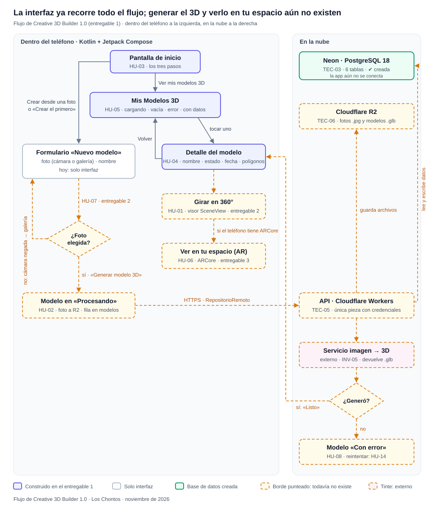
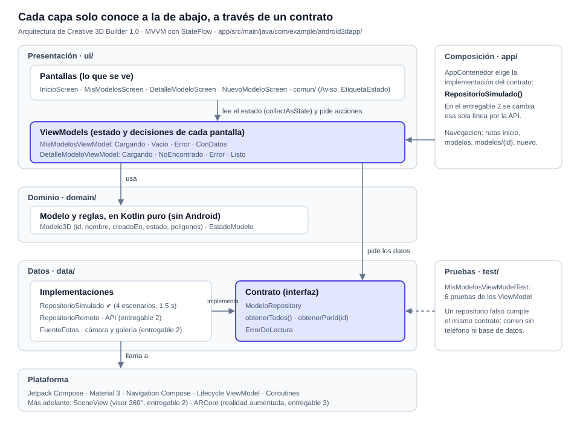

# Creative 3D Builder · Actores, eventos, flujo y arquitectura

**Objetivo del Producto:** «Que un estudiante de ingeniería convierta la foto de un objeto en un modelo 3D que pueda girar
en 360° y ver sobre una superficie real, en menos de dos minutos y desde un celular de gama media». Este documento revisa
si la **versión 1.0 (entregable 1 · fase inicial)** lo cumple.

## Veredicto

**Se cumple la base, todavía no el objetivo.** La interfaz recorre todo el flujo y la base de datos de los tres
entregables ya existe, pero la parte que da valor —convertir la foto en 3D, girarlo y verlo en tu espacio— llega en los
entregables 2 y 3. Nada se ha medido aún con estudiantes reales ni en el Xiaomi del equipo.

| Parte del objetivo | Estado en 1.0 | Por qué |
|---|---|---|
| «Que un estudiante de ingeniería…» | Sin medir | La persona sale del examen del Sprint 1; falta la prueba con dos estudiantes (INV-02) |
| «…convierta la foto de un objeto en un modelo 3D…» | No existe aún | El formulario «Nuevo modelo» es solo interfaz; HU-07 y HU-02 son del entregable 2 |
| «…que pueda girar en 360°…» | No existe aún | El detalle reserva el espacio del visor; HU-01 es del entregable 2 |
| «…y ver sobre una superficie real…» | No existe aún | HU-06 (ARCore) es del entregable 3 |
| «…en menos de dos minutos…» | Sin medir | Se mide con cronómetro cuando exista la generación (entregable 2) |
| «…desde un celular de gama media» | Parcial | Corre en un emulador Android 16; falta el Xiaomi |
| Base de datos para todo lo anterior | Construido | 6 tablas en Neon (PostgreSQL 18); la app aún no se conecta, por diseño |

## Actores

Una persona usa la app; un compañero puede recibir lo que sale de ella, y seis piezas técnicas hacen el trabajo. Solo
tres existen hoy: el estudiante, Android y la base de datos.

| Actor | Tipo | Qué hace | Qué espera | Existe en 1.0 |
|---|---|---|---|---|
| Estudiante de ingeniería (Xiaomi de gama media, conexión inestable en el bus) | Primario, usa la app | Abre la app, revisa sus modelos, crea uno desde una foto, lo gira y lo pone en su espacio | Ver su idea en 3D rápido, sin saber modelar ni tener computador | Sí |
| Compañero de clase | Receptor | Recibe el enlace o el archivo del modelo (HU-12, HU-09) | Verlo sin instalar nada | No (entregable 3) |
| Android (permisos) | Sistema | Concede o niega cámara y almacenamiento | — | Sí |
| Cámara y galería | Sistema | Entregan la foto del objeto (HU-07) | — | No (entregable 2) |
| API · Cloudflare Workers | Sistema | Recibe la foto, habla con la base, con R2 y con el servicio de imagen a 3D; es la única pieza con credenciales (TEC-05) | — | No (entregable 2) |
| Base de datos · Neon (PostgreSQL 18) | Sistema | Guarda usuarios, modelos, fotos, trabajos de generación y archivos 3D (TEC-03) | — | **Sí** |
| Cloudflare R2 | Sistema | Guarda los archivos: fotos `.jpg` y modelos `.glb` (TEC-06) | — | No (entregable 2) |
| Servicio de imagen a 3D | Sistema externo, no lo controla el equipo | Convierte la foto en un modelo `.glb` (INV-05 elige cuál) | Una foto nítida del objeto | No (entregable 2) |
| ARCore | Sistema | Detecta superficies y coloca el modelo (HU-06) | Un teléfono compatible (INV-06) | No (entregable 3) |

## Eventos

La app tiene **16 eventos de dominio**, en el orden en que ocurren. Los seis primeros y el último existen en la 1.0; los
demás están planeados y tienen su historia en el backlog.

| # | Evento | Lo dispara | Qué cambia | Historia | Entrega |
|---|---|---|---|---|---|
| 1 | App abierta | Estudiante | Pantalla de inicio con los tres pasos y su entregable | HU-03 | 1 ✔ |
| 2 | Lista abierta | Estudiante | «Mis Modelos 3D» muestra cargando, vacía, error o con datos, del más reciente al más antiguo | HU-05 | 1 ✔ |
| 3 | Escenario cambiado | Developer, solo en compilación de depuración | La lista se recarga en el estado elegido | INV-04 | 1 ✔ |
| 4 | Detalle abierto | Estudiante, al tocar un modelo | Nombre, estado, fecha, polígonos e identificador, por id | HU-04 | 1 ✔ |
| 5 | Modelo no encontrado | App | «Este modelo ya no existe» y la vuelta a la lista | HU-04 | 1 ✔ |
| 6 | Formulario abierto | Estudiante, con «Crear desde una foto» o «Crear el primero» | Formulario con nombre (máx. 80) y aviso; «Generar» desactivado | HU-03 | 1 ✔ (interfaz) |
| 7 | Foto elegida (o cancelada, cámara negada) | Estudiante + cámara | La foto queda en el formulario; si se niega la cámara, se ofrece la galería | HU-07 | 2 |
| 8 | Generación pedida | Estudiante | Fila en `modelos` con estado *procesando*, foto en R2, fila en `fotos` | HU-02 · TEC-05 · TEC-06 | 2 |
| 9 | Trabajo en cola | API | Fila en `trabajos_generacion` (*en_cola* → *procesando*) | HU-08 | 2 |
| 10 | Modelo listo | Servicio de imagen a 3D → API | `.glb` en R2, fila en `archivos_modelo`, estado *listo* y polígonos | HU-02 | 2 |
| 11 | Generación fallida | Servicio o API | Estado *error* con su mensaje; se puede reintentar | HU-08 · HU-14 | 2 |
| 12 | Modelo girado | Estudiante, con el dedo | Visor 360° con zoom | HU-01 | 2 |
| 13 | Modelo borrado | Estudiante, con confirmación | Se borran la fila, sus fotos y archivos | HU-10 | 2 |
| 14 | Modelo puesto en tu espacio (o teléfono sin ARCore) | Estudiante + ARCore | El modelo aparece sobre la superficie; si no hay ARCore, vuelve al visor 360° | HU-06 | 3 |
| 15 | Modelo exportado o compartido | Estudiante + menú de compartir | Archivo `.glb`/`.stl` o enlace | HU-09 · HU-12 | 3 |
| 16 | Base actualizada | Equipo, al aplicar una migración | `esquema_version` sube sin perder datos (hoy: versión 1) | TEC-03 | 1 ✔ |

## Flujo completo

Todo lo de la izquierda pasa dentro del teléfono; lo de la derecha, en la nube. La línea continua existe hoy; **la línea
punteada es lo que falta**, y la pieza que la abre es la API del entregable 2.

*Flujo de Creative 3D Builder 1.0 · teléfono a la izquierda, nube a la derecha.*

## Arquitectura por capas

La app sigue MVVM en cuatro capas. La regla es una: **las flechas solo bajan**. Ninguna pantalla habla con el
repositorio; lo pide a su ViewModel, y el ViewModel lo pide a un contrato.

*Arquitectura de Creative 3D Builder 1.0 · cuatro capas, composición y pruebas al lado.*

Los ViewModels y el contrato (resaltados) son las dos bisagras. Las pruebas cambian la implementación por un repositorio
falso y corren sin teléfono; en el entregable 2, pasar de datos simulados a la API será cambiar **una línea** en
`app/AppContenedor.kt`.

| Capa | Carpeta | Responde por | Depende de | Cómo se prueba |
|---|---|---|---|---|
| Presentación | `ui/` | Qué se ve y qué se toca | ViewModels | Capturas en el emulador; ficha en el Xiaomi (pendiente) |
| ViewModels | `ui/*/…ViewModel.kt` | Estado de cada pantalla y reglas de uso (vacío ≠ error, no encontrado) | Contrato | 6 pruebas unitarias (`MisModelosViewModelTest`) |
| Dominio | `domain/` | El modelo 3D y sus estados, iguales a la tabla `modelos` | Nada (Kotlin puro) | A través de las pruebas del ViewModel |
| Datos | `data/` | Obtener los modelos | Contrato | Repositorio falso en las pruebas |
| Composición | `app/` | Qué implementación se usa y las rutas | Todo | Navegar en el emulador |
| Plataforma | Compose, Navigation, Coroutines | Hardware y sistema operativo | — | En el teléfono |

**Una capa que hoy no existe: el servidor.** La API (TEC-05) entra como otra implementación del contrato
`ModeloRepository` —`RepositorioRemoto`— sin tocar las pantallas.

## Trazabilidad

Las historias del entregable 1 tienen sus escenarios Gherkin en `docs/criterios/`; 7 pruebas automáticas pasan. Ninguna
tiene aún su prueba en el Xiaomi: eso es lo que convierte «construido» en «Hecho».

| Historia | Parte del objetivo que cubre | Pruebas automáticas | En el Xiaomi |
|---|---|---|---|
| HU-03 Pantalla de inicio | Que el estudiante entienda qué hace la app | — (verificada en emulador) | Pendiente |
| HU-05 Mis Modelos 3D | Consultar lo que ya hizo | Pasan (3) | Pendiente |
| HU-04 Detalle de un modelo | Consultar lo que ya hizo | Pasan (2) | Pendiente |
| TEC-02 MVVM | Base de todo | Pasan (1, repositorio falso) | n/a |
| TEC-03 Base de datos | Persistencia para los 3 entregables | Consulta en Neon | n/a |

## Brechas y decisiones abiertas

La brecha mayor es que **todavía no se genera ningún modelo 3D**: casi todas las demás dependen de elegir el servicio de
imagen a 3D (INV-05).

| Brecha | Efecto en el propósito | Qué la cierra | Entrega |
|---|---|---|---|
| No hay generación de 3D | La app aún no convierte fotos | INV-05 + HU-07 + HU-02 + TEC-05 | 2 |
| La app no se conecta a la base | Los datos son de prueba | TEC-05 (API) y `RepositorioRemoto` | 2 |
| Sin prueba en el Xiaomi | Nada pasa a «Hecho» | Instalar el APK y llenar la ficha | 1 |
| Sin prueba con estudiantes | No se sabe si se entiende ni si dura menos de dos minutos | INV-02 | 1 |
| No se sabe si el Xiaomi tiene ARCore | El entregable 3 podría no correr en ese teléfono | INV-06 | 3 |
| El servicio de imagen a 3D puede costar | Límite de modelos por mes | INV-05 compara costo y cuota gratuita | 2 |

**Decisiones abiertas**
- Elegir el servicio de imagen a 3D (INV-05): la decisión que más acerca la app a su propósito.
- Decidir si habrá inicio de sesión o un usuario anónimo por teléfono (afecta a la tabla `usuarios`).
- Pedir al docente que confirme que el Hito 3 se cubre con la API del entregable 2 más la cámara.

---
Creative 3D Builder · Los Chontos · Docente: Cipriano López · Desarrollo de Aplicaciones Móviles · UNIPAZ · noviembre de 2026
