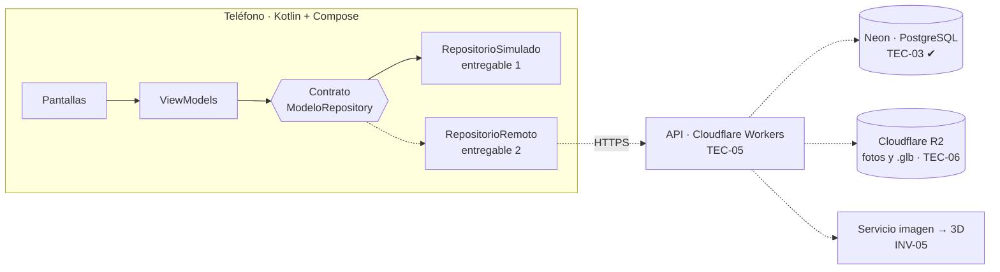
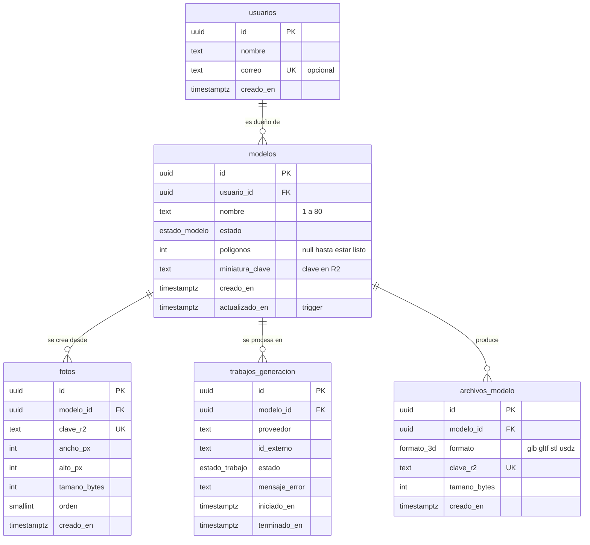

# Base de datos de Creative 3D Builder

> TEC-03 · Entregable 1. Responsable: Erick Martinez. Motor: **PostgreSQL 18** en **Neon**, proyecto «Builder 3D»,
> rama `production`, base `neondb`.

## Veredicto

**El esquema de los tres entregables está creado en Neon** (migración 001, verificada el 4 de noviembre de 2026), con los
mismos seis modelos de ejemplo que muestra la app. **La app todavía no se conecta**: en el entregable 1 usa
`RepositorioSimulado`, y la conexión llega con la API (TEC-05) en el entregable 2. Es una decisión de diseño, no una falta.

## Cómo encaja en la arquitectura

*Línea continua: existe hoy. Línea punteada: entregable 2.* **La app nunca tiene las credenciales de la base**: solo
conocerá la URL de la API (OWASP Mobile M1 · credenciales indebidas).

## Diagrama entidad-relación

## Qué tabla sirve a qué entregable

| Tabla | Para qué | Entregable | Historia |
|---|---|---|---|
| `usuarios` | Dueño de cada modelo | 1 | HU-05 |
| `modelos` | «Mis Modelos 3D» y su detalle | 1 | HU-05 · HU-04 |
| `fotos` | Foto(s) de origen | 2 | HU-07 |
| `trabajos_generacion` | Seguir la conversión foto → 3D | 2 | HU-02 · HU-08 · HU-14 |
| `archivos_modelo` | El `.glb` que usan el visor y la AR | 2 · 3 | HU-01 · HU-06 · HU-09 |
| `esquema_version` | Qué migraciones se aplicaron | — | TEC-03 |

## Diccionario de datos

### `modelos`

| Columna | Tipo | Nulo | Regla | Por qué |
|---|---|---|---|---|
| `id` | UUID | No | `gen_random_uuid()` | Se puede crear en el teléfono antes de subir; no revela cuántos modelos hay |
| `usuario_id` | UUID | No | FK → `usuarios`, `ON DELETE CASCADE` | Al borrar un usuario se borra todo lo suyo |
| `nombre` | TEXT | No | 1 a 80 caracteres | Igual al límite del formulario «Nuevo modelo» |
| `estado` | `estado_modelo` | No | `borrador` · `procesando` · `listo` · `error` | Igual a `EstadoModelo` en `domain/Modelo3D.kt` |
| `poligonos` | INTEGER | Sí | ≥ 0; obligatorio si `estado = 'listo'` | Un modelo sin malla aún no tiene polígonos |
| `miniatura_clave` | TEXT | Sí | — | Clave del archivo en R2, no la imagen |
| `creado_en` | TIMESTAMPTZ | No | `now()` | Ordena la lista (índice `idx_modelos_usuario_fecha`) |
| `actualizado_en` | TIMESTAMPTZ | No | trigger `trg_modelos_actualizado` | Se mantiene solo en cada `UPDATE` |

### `trabajos_generacion`

| Columna | Tipo | Nulo | Regla |
|---|---|---|---|
| `proveedor` | TEXT | No | Servicio de imagen a 3D (se decide en INV-05) |
| `id_externo` | TEXT | Sí | Id del trabajo en el proveedor |
| `estado` | `estado_trabajo` | No | `en_cola` · `procesando` · `terminado` · `fallido` |
| `mensaje_error` | TEXT | Sí | Obligatorio si `estado = 'fallido'` |
| `terminado_en` | TIMESTAMPTZ | Sí | No puede ser anterior a `iniciado_en` |

### `fotos` y `archivos_modelo`

Guardan **la clave del archivo en R2, nunca el archivo**. `clave_r2` es única. En `archivos_modelo` hay un solo archivo
por formato y modelo (`UNIQUE (modelo_id, formato)`).

## Decisiones de diseño

| Decisión | Alternativa descartada | Motivo |
|---|---|---|
| Esquema completo desde el entregable 1 | Crear tablas sprint a sprint | Así lo acordó el equipo; las migraciones siguientes solo agregan |
| Archivos en R2, claves en la base | Guardar imágenes y `.glb` como `BYTEA` | Una foto pesa megas; la base se vuelve lenta y cara |
| `trabajos_generacion` aparte de `modelos` | Una columna `estado` y listo | Un intento puede fallar y reintentarse (HU-14) sin perder el modelo |
| UUID | Entero autoincremental | Ids creados sin conexión y no adivinables |
| Tipos `ENUM` | Texto libre | La base rechaza estados que la app no conoce |
| Migraciones numeradas + `esquema_version` | Editar el SQL a mano | Mismo patrón que `versionEsquema` del proyecto modelo del curso |

## Cómo se crea o se recrea

Ver [`../db/README.md`](../db/README.md).

## Evidencia (4 de noviembre de 2026)

Consulta sobre Neon después de aplicar la migración y la semilla:

| Tabla | Columnas |
|---|---|
| `archivos_modelo` | 6 |
| `esquema_version` | 3 |
| `fotos` | 8 |
| `modelos` | 8 |
| `trabajos_generacion` | 8 |
| `usuarios` | 4 |

`SELECT nombre, estado, poligonos FROM modelos ORDER BY creado_en DESC` devuelve los seis modelos de la app en el mismo
orden que la captura `docs/capturas/entregable-1/03-mis-modelos-con-datos.png`.
