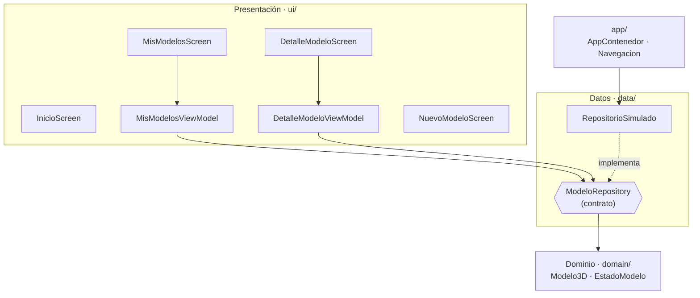
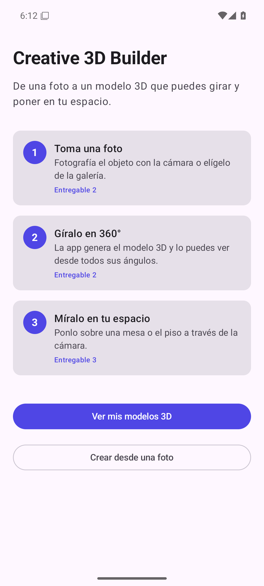
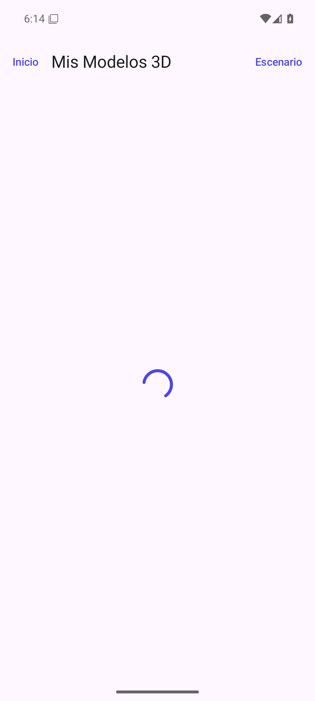
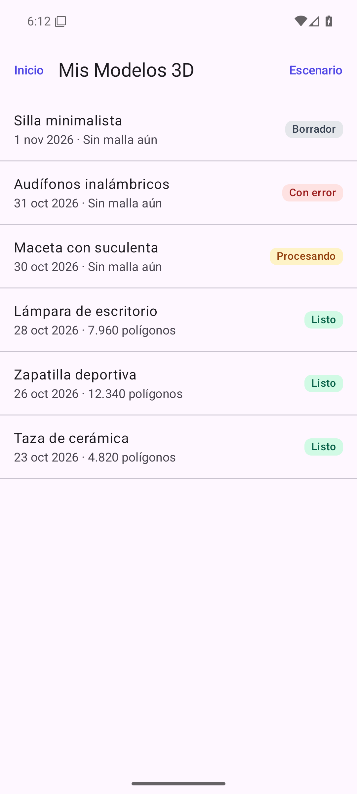
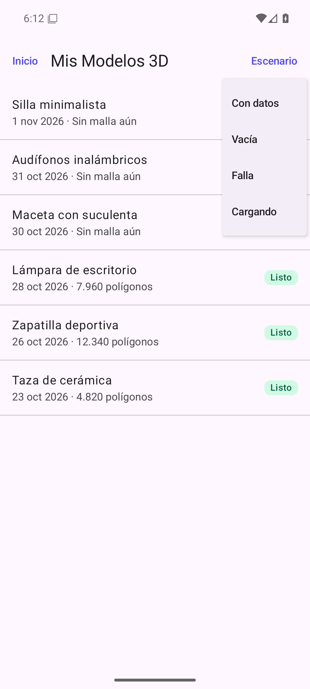
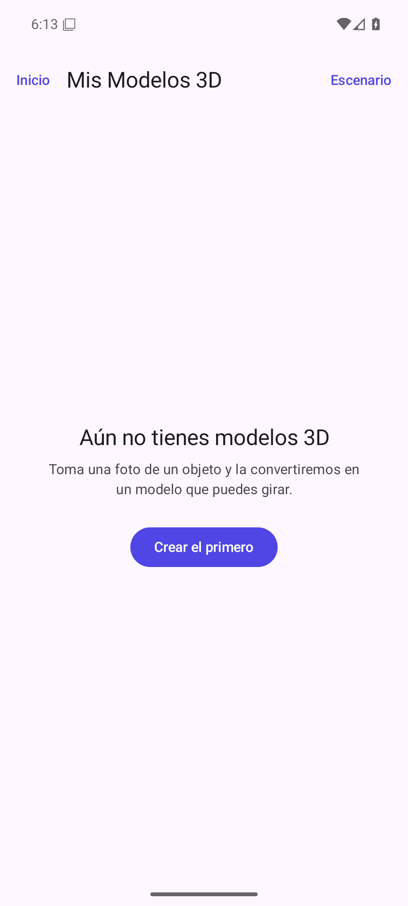
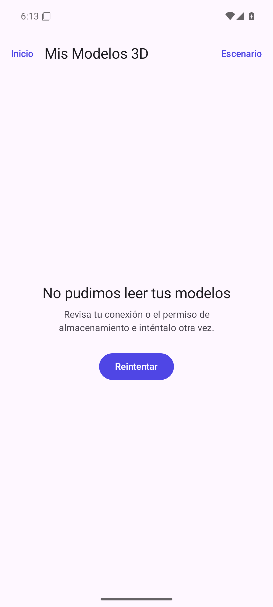
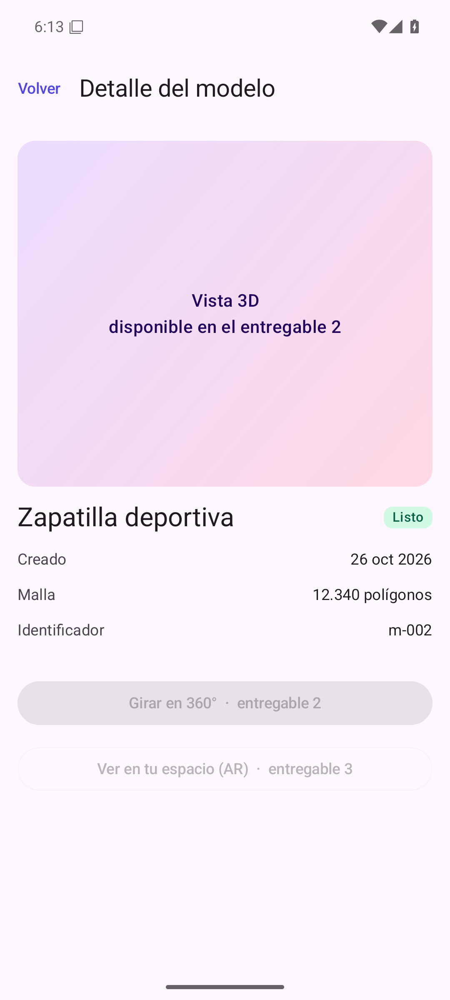
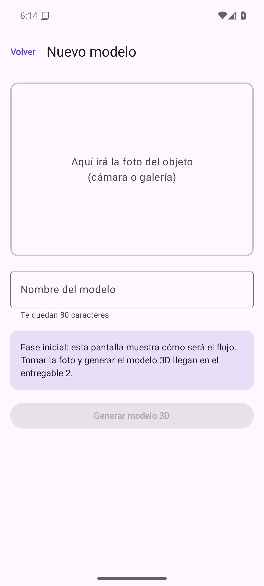

# Entregable 1 · Fase inicial

> Primer entregable del plan de tres ([`../vision-y-alcance.md`](../vision-y-alcance.md)). Hito de GitHub:
> *Entregable 1 · Fase inicial*. Rama: `entregable-1/fase-inicial`.

## Veredicto

**Construido; falta probarlo en el teléfono real.** La interfaz de la fase inicial funciona en un emulador Android 16
(API 36) con sus cuatro estados, el detalle por id y la separación pantalla · ViewModel · contrato que pide el curso. El
esquema completo de la base de datos está creado en Neon. Para que pase de *construido* a **Hecho** faltan tres cosas que
no se inventan: probarlo en el **Xiaomi** del equipo, la **revisión del PR** por otro integrante y la **validación con
dos estudiantes** (INV-02).

| Parte del entregable | Estado | Por qué |
|---|---|---|
| «se ve la interfaz de la aplicación» | **Construido** | Inicio, Mis Modelos 3D (4 estados), Detalle y Nuevo modelo; 8 capturas del emulador |
| «la base de datos está creada» | **Hecho** | Migración 001 y semilla aplicadas en Neon; verificado con una consulta |
| «no tienen que estar conectados» | **Cumplido por diseño** | La app usa `RepositorioSimulado`; conectarla es cambiar una línea en `AppContenedor.kt` |
| Tablero con las actividades | **Parcial** | 24 issues con ID e hitos creados; falta el permiso del dueño para configurar el tablero |
| Validación con usuarios | **Pendiente** | INV-02, con dos estudiantes reales |

## Sprint Planning

**¿Por qué es valioso este entregable?** Objetivo:

> «Al abrir la app en un Android se ve su interfaz completa —inicio, Mis Modelos 3D con sus cuatro estados, detalle y
> nuevo modelo— con datos simulados, y el esquema de la base de datos de los tres entregables está creado en Neon».

Se responde con sí o no: **sí en el emulador; en el Xiaomi, pendiente.**

**¿Qué se puede terminar?**

| ID | Elemento | Pts | Depende de |
|---|---|---|---|
| TEC-01 | Proyecto Kotlin + Compose (#14) | 2 | — |
| TEC-02 | MVVM: pantalla, ViewModel y contrato (#15) | 3 | TEC-01 |
| TEC-03 | Esquema en Neon (#16) | 3 | — |
| HU-05 | Mis Modelos 3D (#18) | 3 | TEC-02 |
| HU-04 | Detalle de un modelo (#19) | 2 | HU-05 |
| HU-03 | Pantalla de inicio (#17) | 2 | TEC-02 |
| INV-07 | Documentación y evidencias (#22) | 2 | todos |

**Total: 15 puntos** (13 del producto + 2 de documentación).

**¿Cómo se hará?** Decisiones técnicas:

1. **La pantalla muestra, el ViewModel decide.** Cada pantalla lee un `StateFlow` con `collectAsState()` y nunca llama
   al repositorio. Así quedan separadas las tres piezas que el examen del Sprint 1 pedía y que el PR #13 aún no tenía.
2. **El contrato primero.** `ModeloRepository` es una interfaz; `RepositorioSimulado` la cumple hoy y
   `RepositorioRemoto` la cumplirá en el entregable 2. El cambio se hace en **una línea**: `app/AppContenedor.kt`.
3. **Esquema completo, conexión después.** Se crea en Neon todo el modelo de datos de los tres entregables, pero la app no
   se conecta: así la base se diseña con calma y no frena la interfaz.
4. **El modelo de dominio refleja la base.** `Modelo3D` tiene los campos de la tabla `modelos`, y `EstadoModelo` es el
   mismo `ENUM` `estado_modelo`.
5. **Lo que llega después se ve, pero desactivado.** «Girar en 360°», «Ver en tu espacio» y «Generar modelo 3D» aparecen
   con su entregable al lado, para que la interfaz cuente el plan completo sin prometer lo que aún no hace.

## Arquitectura

**La regla:** las flechas solo bajan. Ninguna pantalla conoce al repositorio.

| Capa | Carpeta | Responde por | Depende de | Cómo se prueba |
|---|---|---|---|---|
| Presentación | `ui/` | Qué se ve y qué se toca | ViewModels | Capturas en el emulador; ficha en el teléfono (pendiente) |
| ViewModels | `ui/*/…ViewModel.kt` | Estado de cada pantalla: cargando, vacío, error, con datos | Contrato | `MisModelosViewModelTest` (6 pruebas) |
| Dominio | `domain/` | El modelo 3D y sus estados | Nada (Kotlin puro) | A través de las pruebas del ViewModel |
| Datos | `data/` | Obtener los modelos | Contrato | Las mismas pruebas, con un repositorio falso |
| Composición | `app/` | Qué implementación se usa y las rutas | Todo | Navegar en el emulador |

## Lo que produjo

| Elemento | Resultado | Dónde quedó |
|---|---|---|
| TEC-02 | Pantalla, ViewModel (`StateFlow`) y contrato separados; navegación por rutas con `modelos/{id}` | `app/src/main/java/.../app`, `data`, `ui` |
| HU-05 | Lista ordenada del más reciente al más antiguo; cuatro estados; etiqueta de color por estado; selector de escenarios solo en depuración | `ui/modelos/` |
| HU-04 | Detalle por id: nombre, estado, fecha, polígonos e id; «Este modelo ya no existe»; «Volver» | `ui/detalle/` |
| HU-03 | Inicio con los tres pasos del producto y su entregable | `ui/inicio/` |
| — | Formulario «Nuevo modelo» (solo interfaz) con contador de caracteres | `ui/nuevo/` |
| TEC-03 | 6 tablas, 3 `ENUM`, 4 índices, 1 trigger; semilla con 6 modelos | `db/`, Neon «Builder 3D» |
| INV-07 | Visión, backlog, tablero, flujo, base de datos, criterios Gherkin, plantillas de issue y PR, capturas e informe formal | `docs/`, `.github/` |
| Pruebas | De 1 a 7 pruebas unitarias | `app/src/test/` |

## Escenarios y dónde se comprueban

| Historia | Escenario | Prueba automática | Emulador (API 36) | Xiaomi |
|---|---|---|---|---|
| HU-05 | Lista con datos | ✔ `con datos - los modelos se ven del mas reciente…` | ✔ captura 03 | Pendiente |
| HU-05 | No se pueden leer | ✔ `falla al leer - muestra error y reintentar…` | ✔ captura 06 | Pendiente |
| HU-05 | Primera instalación | ✔ `primera instalacion - sin modelos la lista queda vacia…` | ✔ captura 05 | Pendiente |
| HU-05 | Mientras carga | — | ✔ captura 02 | Pendiente |
| HU-04 | Abrir el detalle | ✔ `detalle - abre el modelo por su id` | ✔ captura 07 | Pendiente |
| HU-04 | El modelo ya no existe | ✔ `detalle - un id que no existe no es un error` | — | Pendiente |
| HU-04 | Volver a la lista | — | ✔ (se tocó «Volver») | Pendiente |
| HU-03 | Primer vistazo | — | ✔ captura 01 | Pendiente |
| HU-03 | Función que aún no existe | — | ✔ captura 08 | Pendiente |
| HU-03 | Pantalla pequeña (360 dp) | — | Pendiente (`adb shell wm size 720x1600`, `wm density 320`) | Pendiente |

> La columna «Xiaomi» la llena el equipo con el APK de la rama instalado en el teléfono. Lo que no coincida es lo que se
> anota. No se marca por adelantado.

## Evidencias

| # | Captura | Qué muestra |
|---|---|---|
| 1 |  | HU-03 · inicio con los tres pasos |
| 2 |  | HU-05 · cargando |
| 3 |  | HU-05 · con datos, del más reciente al más antiguo |
| 4 |  | Selector de escenarios (solo depuración) |
| 5 |  | HU-05 · primera instalación |
| 6 |  | HU-05 · no se pueden leer |
| 7 |  | HU-04 · detalle por id |
| 8 |  | Nuevo modelo, solo interfaz |

*Capturas tomadas con `adb shell screencap` en un emulador Pixel 6, Android 16 (API 36), 1080 × 2400.*

**Comprobaciones automáticas** (4 de noviembre de 2026):

| Comando | Resultado |
|---|---|
| `./gradlew assembleDebug` | BUILD SUCCESSFUL |
| `./gradlew testDebugUnitTest` | 7 pruebas, 0 fallos |
| `./gradlew lintDebug` | 0 errores, 12 avisos: 5 de versiones nuevas disponibles y 7 de colores sin usar de la plantilla original (`colors.xml`) |

## Definición de Terminado · estado al cierre

| Casilla | TEC-02 | TEC-03 | HU-05 | HU-04 | HU-03 |
|---|---|---|---|---|---|
| Criterios comprobados en Android físico | n/a | n/a | ☐ | ☐ | ☐ |
| PR revisado por otra persona y fusionado | ☐ | ☐ | ☐ | ☐ | ☐ |
| Lint sin errores y pruebas pasan | ✔ | n/a | ✔ | ✔ | ✔ |
| 360 dp sin desbordes | n/a | n/a | ☐ | ☐ | ☐ |
| Cuatro estados en las listas | n/a | n/a | ✔ | n/a | n/a |
| Áreas táctiles de 48 dp | n/a | n/a | ✔ | ✔ | ✔ |
| Sin credenciales en el código | ✔ | ✔ | ✔ | ✔ | ✔ |

## Brechas y decisiones abiertas

| Brecha | Efecto | Qué la cierra |
|---|---|---|
| No se ha probado en el Xiaomi | Nada pasa a «Hecho» | Instalar el APK de la rama y llenar la columna «Xiaomi» |
| El PR no tiene revisión | No se puede fusionar según la DoD | Revisión de otro integrante |
| El tablero no está configurado | Falta lo que mide la rúbrica del Sprint 0 (columnas, campos, vistas) | Rol Write del dueño + `scripts/configurar-tablero.sh` |
| INV-02 sin hacer | El objetivo dice «un estudiante de ingeniería», pero no se ha probado con ninguno | Dos entrevistas de 15 minutos |
| `master` sin proteger | Se puede subir sin revisión | *Settings → Branches → Add rule* (lo hace el dueño) |

## Para la Review

1. Demo en el teléfono: inicio → Mis Modelos 3D → cambiar los cuatro escenarios → abrir un detalle → volver → nuevo modelo.
2. Mostrar en la consola de Neon las tablas y los seis modelos de la semilla.
3. Mostrar el tablero con el hito *Entregable 1* y sus tarjetas.
4. Pregunta para el docente: ¿el Hito 3 se acepta con la API del entregable 2 (Cloudflare Workers + Neon)?
