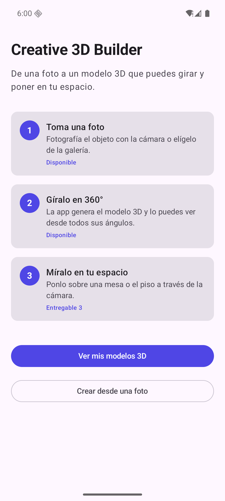
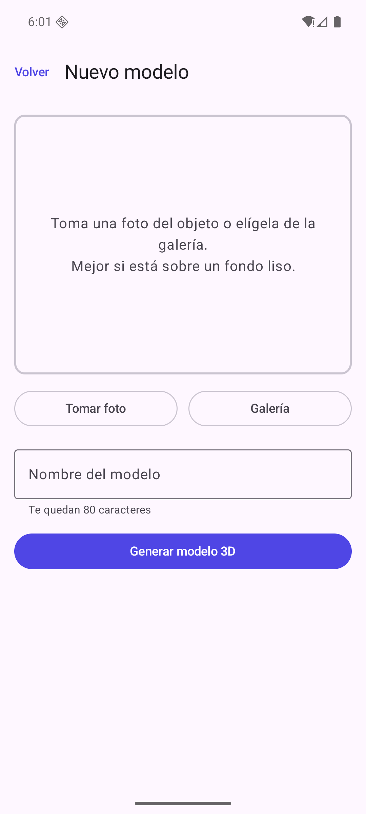
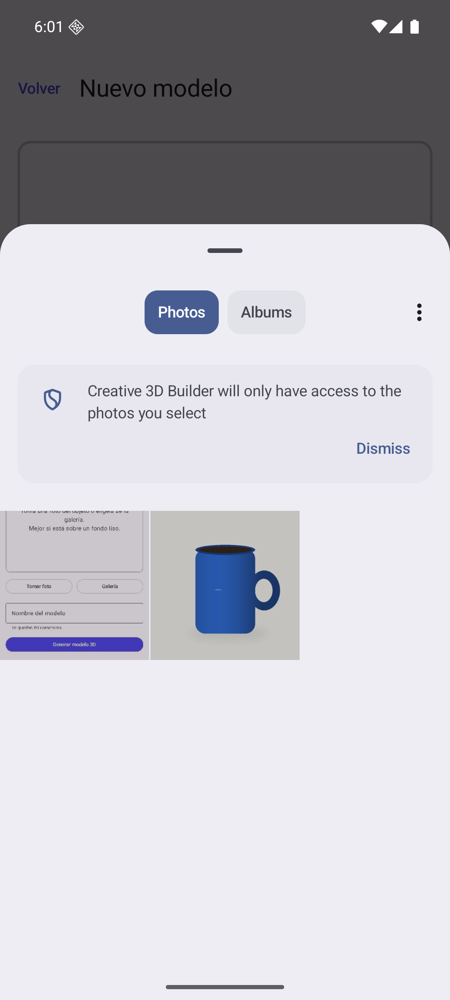
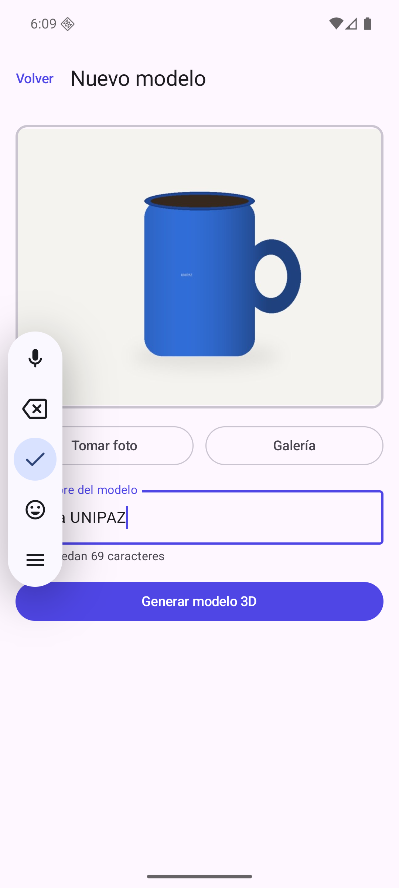
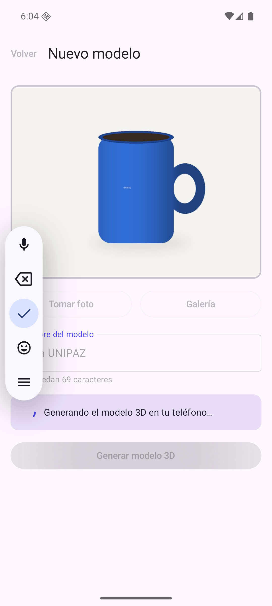
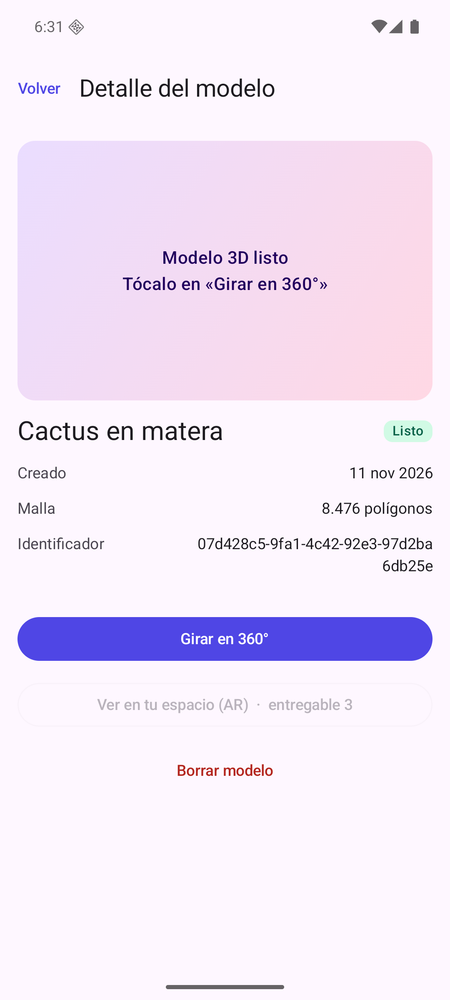
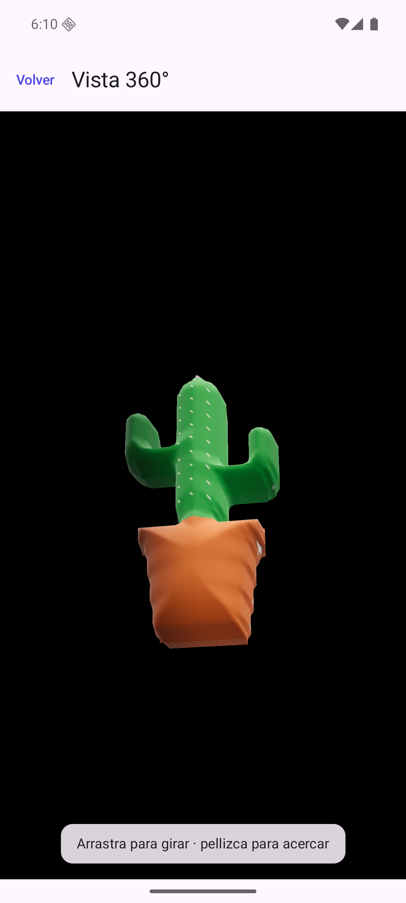
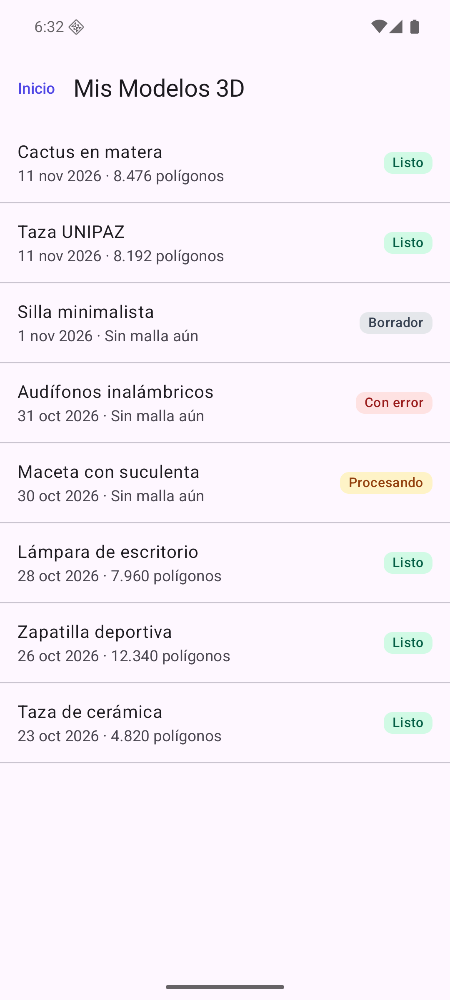
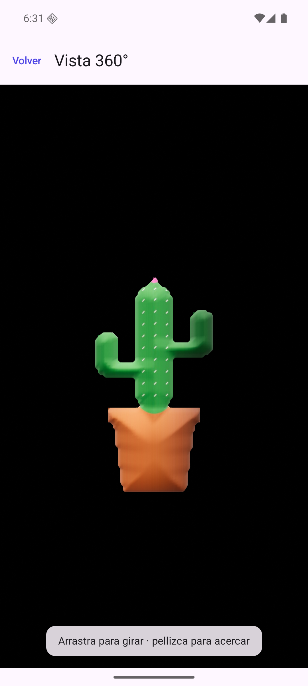

# Entregable 2 · Foto a modelo 3D

> Segundo entregable del plan de tres ([`../vision-y-alcance.md`](../vision-y-alcance.md)). Hito de GitHub:
> *Entregable 2 · Foto a modelo 3D*. Rama: `entregable-2/foto-a-3d`. Versión de la app: **2.0**.

## Veredicto

**Funciona de punta a punta en el teléfono:** se toma o se elige una foto, la app genera un modelo 3D real (`.glb`), lo
sube a la **API publicada en Cloudflare**, que lo guarda en **Neon** (datos) y Workers KV (archivos), y se puede girar
en 360°. Hay dos modelos subidos —una taza y un cactus— y además vienen dentro de la app para usarla sin red. Lo que
falta: el 3D es una **aproximación** (inflado de silueta), no una reconstrucción completa con IA, y no se ha probado en
el Xiaomi.

| Parte del entregable | Estado | Por qué |
|---|---|---|
| «Subir una foto…» (cámara o galería) | **Construido** | Probado con la galería en el emulador; la cámara usa la app de cámara del teléfono (falta probarla en el Xiaomi) |
| «…y que la app me permita modelarlo 3D» | **Construido** | Generador en el teléfono (`MallaInflada` + `EscritorGlb`); unos 8 000 polígonos |
| «…girarlo en 360° y verlo por todos sus ángulos» | **Construido** | Visor SceneView: arrastrar gira, pellizcar acerca |
| Que los modelos queden guardados | **Construido** | En Neon a través de la API; sin API, en el teléfono (`AlmacenLocal`) |
| Dos modelos listos para mostrar | **Hecho** | «Taza UNIPAZ» y «Cactus en matera», subidos desde la app a Neon; copia en `assets/demos/` |
| API + base de datos (Hito 3) | **Construido** | <https://creative-3d-builder-api.creative3dbuilder.workers.dev> · prueba de humo 8/8 · la app la usa |
| Probado en el Xiaomi | **Pendiente** | — |

## Sprint Planning

**Objetivo:** «Un estudiante toma o elige la foto de un objeto y, en segundos, lo ve en 3D y lo gira en 360°».

| ID | Elemento | Pts | Resultado |
|---|---|---|---|
| INV-05 | Elegir el servicio de imagen a 3D (#23) | 2 | Hecho → [`../inv-05-servicio-imagen-3d.md`](../inv-05-servicio-imagen-3d.md) |
| HU-07 | Elegir la foto con la cámara o la galería (#26) | 3 | Construido |
| HU-02 | Crear un modelo 3D a partir de una foto (#27) | 3 | Construido |
| HU-01 | Girar el modelo en 360° (#28) | 3 | Construido |
| HU-08 | Ver el estado de la generación (#29) | 2 | Construido |
| HU-14 | Reintentar una generación fallida (#37) | 2 | Construido |
| HU-10 | Borrar un modelo (#30) | 2 | Construido |
| TEC-05 | API en Cloudflare Workers conectada a Neon (#24) | 5 | Publicada y en uso por la app |
| TEC-06 | Almacenamiento de fotos y modelos (#25) | 3 | Workers KV en uso (R2 cambiado por KV) |

**Decisiones técnicas:**

1. **Generar en el teléfono.** La API de Meshy exige un plan pagado. El inflado de silueta es gratis, funciona sin
   internet y produce un `.glb` estándar que también servirá para la realidad aumentada del entregable 3 (INV-05).
2. **Un contrato más: `GeneradorModelo3D`.** Cambiar a un servicio de IA es agregar una implementación, no tocar
   pantallas.
3. **Sin permisos peligrosos.** La galería usa el selector de fotos de Android y la cámara usa la app de cámara del
   teléfono, así que no se pide ni `CAMERA` ni almacenamiento. Solo `INTERNET`, para la API.
4. **Foto preparada antes de todo.** Se endereza según su EXIF, se reduce a 1600 px y se pasa a JPEG, así pesa poco al
   subirla con datos móviles.
5. **R2 → Workers KV.** R2 exige activarlo con un método de pago; KV es gratis y admite archivos de hasta 25 MiB. La
   columna `clave_r2` guarda la clave de KV, sin migración.
6. **Persistencia local mientras no hay API.** `AlmacenLocal` guarda la lista y los `.glb` en la carpeta privada de la
   app. Con `creative3d.apiUrl` en `gradle.properties`, la misma app pasa a usar la API (una línea en `AppContenedor`).

## Lo que produjo

| Pieza | Dónde |
|---|---|
| Generador: silueta, distancia al borde, inflado, normales | `data/generacion/MallaInflada.kt` |
| Escritor de glTF binario con la foto como textura | `data/generacion/EscritorGlb.kt` |
| Contrato del generador e implementación en el teléfono | `data/generacion/GeneradorModelo3D.kt` |
| Lectura de la foto (EXIF, tamaño, JPEG) | `data/fotos/LectorFotos.kt` |
| Persistencia en el teléfono y modelos de demostración | `data/AlmacenLocal.kt`, `assets/demos/` |
| Repositorio de la API | `data/RepositorioRemoto.kt` |
| Formulario: foto, nombre, generar, estados y reintentar | `ui/nuevo/` |
| Visor 360° | `ui/visor/` |
| Detalle con «Girar en 360°» y «Borrar modelo» | `ui/detalle/` |
| API (Cloudflare Workers + Neon + KV) | `api/` |
| Pruebas | De 7 a 16: `GeneracionTest` (4) y `NuevoModeloViewModelTest` (5) |

## Escenarios y dónde se comprueban

| Historia | Escenario | Prueba automática | Emulador | Xiaomi |
|---|---|---|---|---|
| HU-07 | Elegir de la galería | — | ✔ capturas 03–04 | Pendiente |
| HU-07 | Tomar la foto | — | — (el emulador no tiene un objeto que fotografiar) | **Pendiente, obligatorio** |
| HU-07 | La foto no se puede leer | ViewModel | — | Pendiente |
| HU-02 | Modelo generado | ✔ ViewModel + generador | ✔ capturas 05–06 | Pendiente |
| HU-02 | Falta algo | ✔ `sin foto dice que falta…` | — | Pendiente |
| HU-02 · RC-03 | Menos de 10 s en gama media | — | < 7 s | **Sin medir** |
| HU-14 | Reintentar no vuelve a generar | ✔ | — | Pendiente |
| HU-01 | Girar y acercar | — | ✔ capturas 07–08 | Pendiente |
| HU-01 | Modelo sin archivo 3D | — | ✔ botón desactivado | Pendiente |
| HU-10 | Borrar un modelo propio | ✔ | — | Pendiente |
| — | Los modelos sobreviven al cerrar la app | — | ✔ (cerrar y abrir) | Pendiente |

## Evidencias

| # | Captura | Qué muestra |
|---|---|---|
| 1 |  | Inicio: pasos 1 y 2 «Disponible» |
| 2 |  | Formulario con «Tomar foto» y «Galería» |
| 3 |  | Selector de fotos de Android, sin pedir permisos |
| 4 |  | Foto elegida y nombre |
| 5 |  | «Generando el modelo 3D…» (HU-08) |
| 6 |  | Detalle del modelo nuevo, «Listo», con polígonos |
| 7 |  | Visor 360° |
| 8 |  | El mismo modelo girado |
| 9 |  | «Mis Modelos 3D» leída desde la API: los dos modelos subidos y los datos de ejemplo de Neon |
| 10 |  | Visor 360° con el .glb descargado de la API |

Fotos de origen de las demostraciones: [`../demos/`](../demos/).

## Brechas y decisiones abiertas

| Brecha | Efecto | Qué la cierra |
|---|---|---|
| El 3D es una aproximación | La parte de atrás repite la de adelante | Un servicio de IA con presupuesto (INV-05) |
| Sin prueba en el Xiaomi | Nada pasa a «Hecho» | Instalar el APK y llenar la columna «Xiaomi» |
| La API no tiene inicio de sesión | Cualquiera con la URL podría escribir | Decidir si hay cuentas (decisión abierta desde el entregable 1) |
